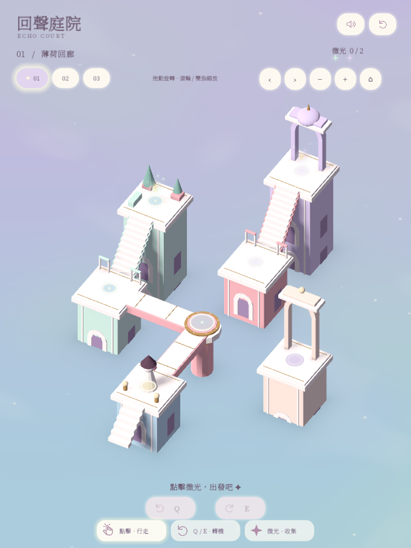
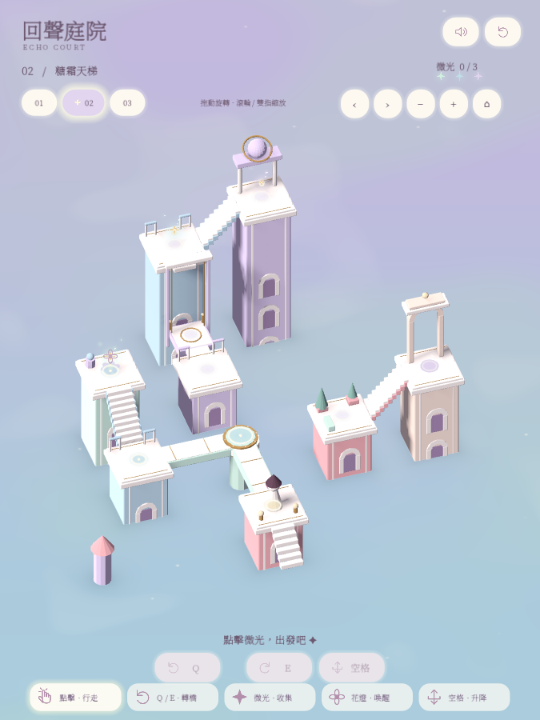
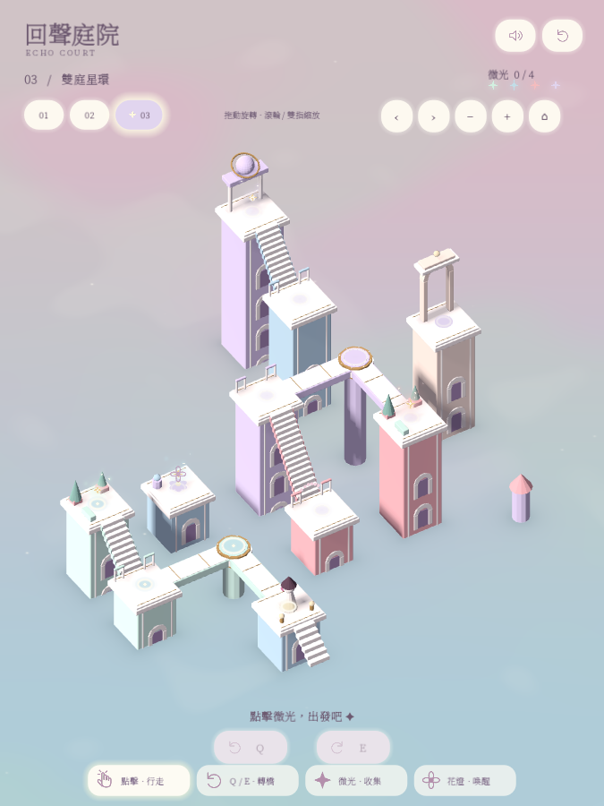

# Echo Court · 回聲庭院

A quiet, playable 3D puzzle prototype built with **Blender + Godot**, developed through iterative conversations with AI.

Turn bridges, awaken flower-shaped switches, ride a lift, and guide a small traveler through pastel courtyards floating over shallow water. Three short chapters, a freely orbiting portrait camera, Traditional Chinese serif typography, and a gentle original soundtrack.

<p align="center">
  
  
  
</p>

**[Watch / download the 15-second gameplay showcase](https://github.com/a0131829/echo-court/releases/latest)** · [Palette](PALETTE.md) · [Asset credits](THIRD_PARTY_NOTICES.md)

## What is playable?

| Chapter | Main mechanism |
| --- | --- |
| Mint Courtyard · 薄荷回廊 | One rotating bridge, two collectible lights, garden and moon pavilion |
| Frosted Stairway · 糖霜天梯 | A switch-activated lift, rooftop paths, three collectible lights |
| Twin Star Courts · 雙庭星環 | Two independent bridges, a gated staircase, four collectible lights |

- Connected paths are traversed by the character, including individual stair steps.
- Collect every light and reach the exit arch to finish a chapter.
- Water ripples respond to buildings the traveler has just crossed, then dissipate. Untouched buildings remain still.
- Flower switches bloom; collectible lights scatter into stars; interaction icons indicate available actions.
- Music loops across chapter changes and gently lowers beneath gameplay sound effects.

## Run locally

Install the standard [Godot editor](https://godotengine.org/download/) (no .NET required). Tested on **Godot 4.7.2, macOS, Compatibility renderer**. Other Godot 4 versions and operating systems have not been verified.

```bash
git clone https://github.com/a0131829/echo-court.git
cd echo-court
# Import assets once, then start the game.
./run.sh --headless --editor --import
./run.sh
```

Alternatively, import `project.godot` into the Godot Project Manager and press **F6** on `main.tscn`, or **F5** to run the project. The included GLB models are ready to use; Blender is only needed to edit or regenerate them.

`run.sh` finds `godot`, `godot4`, or the standard macOS application. To choose another installation:

```bash
GODOT_BIN=/path/to/godot ./run.sh
```

The engine itself is not included in this repository. Windows users can use the Godot editor or run `Godot.exe --path .` after importing the project.

## Controls

| Input | Action |
| --- | --- |
| Click a platform | Walk along an available route |
| Hover over a destination | Preview the route |
| Q / E while on a turntable | Rotate its bridge |
| Space while on an unlocked lift | Ride up or down |
| Drag | Orbit the view; drag vertically to change elevation |
| Mouse wheel / pinch | Zoom |
| Shift + drag / middle-button drag | Pan |
| Arrow keys, + / −, Home | Adjust or reset the camera |
| R / M / Esc | Restart chapter / toggle all audio / exit |
| 01 / 02 / 03 | Switch chapters |

The default window is **675 × 900**, with a **900 × 1200** logical canvas (3:4 portrait). Touch gestures are implemented and covered by synthetic input checks, but have not been tested on a physical mobile device.

## Project layout

| Path | Contents |
| --- | --- |
| `scripts/court.gd` | Gameplay, route finding, mechanisms, UI, music, and verification modes |
| `scripts/orbit_camera.gd` | Orbit, zoom, pan, and gesture handling |
| `scripts/markers.gd` | Route hints, interaction halos, stars, and light trails |
| `shaders/shallow_water.gdshader` | Pastel water and event-triggered ripples |
| `assets/levels.json` | Navigation graphs, chapter definitions, and solution sequences |
| `assets/` | Ready-to-use GLB models, synthesized audio, and bundled font |
| `blender/` | Editable chapter scenes, modular assets, and procedural generator |
| `audio/compose_music.py` | Reproducible original instrumental loop |
| `scripts/*film.gd` | Recording choreography used for gameplay videos |
| `docs/images/` | Screenshots from the game |
| `tests/` | Recorded verification results |

## Rebuild the assets

The geometry and navigation data share the definitions in `blender/build_scene.py`. Tested with Blender 5.2.2 LTS.

```bash
blender --background --python blender/build_scene.py
./run.sh --headless --editor --import
```

**Regeneration overwrites the generated `.blend`, `.glb`, and `levels.json` files.** Save hand-edited models separately, or make lasting changes in the generator.

The music generator requires Python, NumPy, and SciPy:

```bash
python3 -m venv .venv
.venv/bin/pip install -r audio/requirements.txt
.venv/bin/python audio/compose_music.py
./run.sh --headless --editor --import
```

## Verification

```bash
# Complete all three chapters and verify mechanism / navigation rules.
./run.sh --headless -- --self-test

# Verify orbit views, anchored zoom, drag-versus-click, and touch handling.
# Requires a graphical session; also saves screenshots to preview/.
./run.sh -- --camera-test

# Capture each chapter from its starting view.
./run.sh -- --capture
```

The gameplay checks cover blocked routes, four bridge orientations, independent turntables, lift unlocking and return trips, gated stairs, intermediate collection, victory conditions, and chapter resets.

## Scope and inspiration

Echo Court is an original small prototype inspired by the calm architectural puzzle atmosphere of *Monument Valley*. It does not use that game's models, characters, levels, audio, or branding, and is not affiliated with its creators.

This project grew from an initial prompt into a playable prototype through repeated visual direction, implementation, and testing. The polished showcase reflects those iterations, rather than a single untouched generation.

Current limitations: no impossible-perspective connections, no persistent save system, no packaged mobile or web build. Chapter completion is retained only within the current session. The in-game interface is Traditional Chinese; repository documentation is English.

<details>
<summary>Solution hints (spoilers)</summary>

1. **Mint Courtyard:** garden → turntable left → moon pavilion → turntable left → exit.
2. **Frosted Stairway:** flower switch → turntable left → lift up → star terrace → lift down → turntable left → exit.
3. **Twin Star Courts:** garden → lower turntable left → stair switch → lower turntable left → upper courtyard → upper turntable left → star terrace → upper turntable left → exit.

</details>
